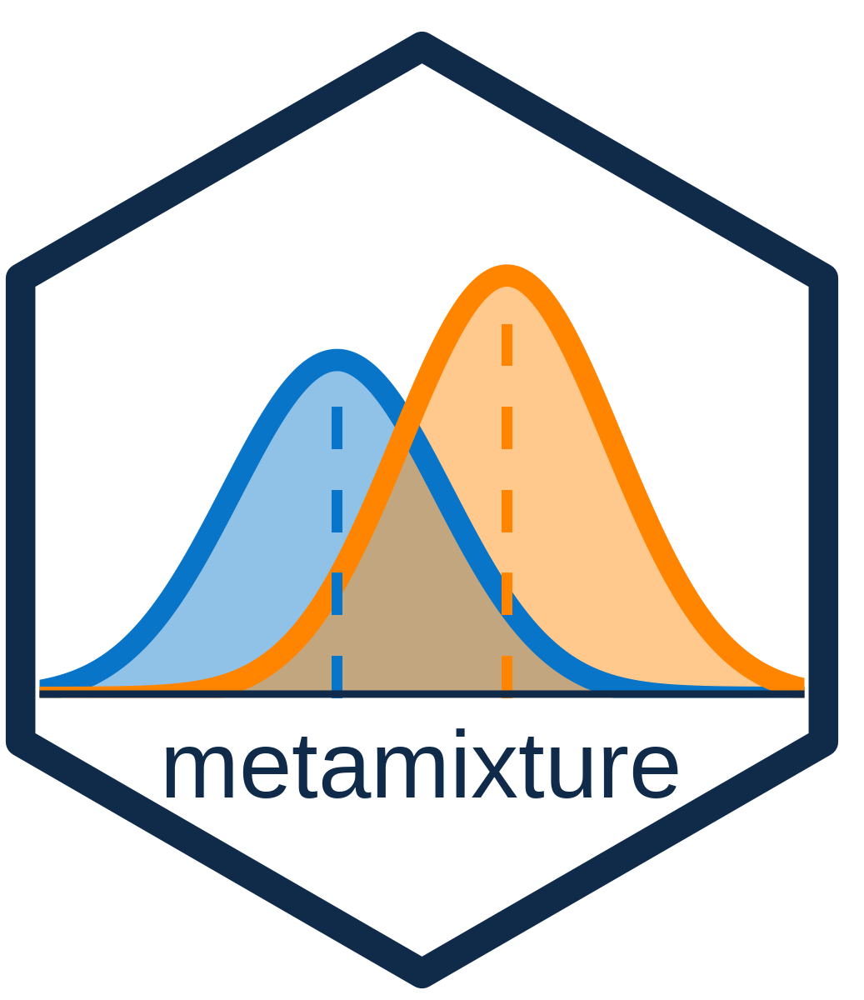

<!-- README.md is generated from README.Rmd. Please edit that file -->

# metamixture <a href='https://github.com/cjvanlissa/metamixture'></a>

<!-- badges: start -->

[](https://github.com/cjvanlissa/metamixture/actions/workflows/R-CMD-check.yaml)
<!-- badges: end -->

Generate, estimate, and report random-effects mixture (‘remix’) models
for meta-analysis. Model estimation relies on ‘OpenMx’, and tidy
reporting relies occurs via ‘tidySEM’. The resulting models can be
further customized and used for auxiliary variable analyses.

## Installation

You can install the development version of metamixture from
[GitHub](https://github.com/) with:

``` r
# install.packages("pak")
pak::pak("cjvanlissa/metamixture")
```

## Documentation

Every user-facing function in the package is documented, and the
documentation can be accessed by running `?function_name` in the R
console, e.g., `?remix`.

Furthermore, there are vignettes:

- [Auxiliary
  analysis](https://cjvanlissa.github.io/metamixture/articles/auxiliary.html):
  Examine relationships between latent class membership and external
  variables using BCH, one-step and two-step maximum likelihood, and
  pseudo-class methods.

## Citing `metamixture`

Please use the following citation for both the method and the R-package:

> Van Lissa, C. J. (2026, November 5). When One Random Effect Is Not
> Enough: Mixture Model Meta-Analysis. Retrieved from
> [osf.io/preprints/psyarxiv/6b437_v1](https://osf.io/preprints/psyarxiv/6b437_v1)

## Contributing and Contact Information

If you have ideas, please get involved. You can contribute by opening an
issue on ‘GitHub’, or sending a pull request with proposed features (see
further instructions below).

- File a ‘GitHub’ issue
  [here](https://github.com/cjvanlissa/metamixture)
- Make a pull request
  [here](https://github.com/cjvanlissa/metamixture/pulls)

By participating in this project, you agree to abide by the [Contributor
Covenant](https://www.contributor-covenant.org/version/2/0/code_of_conduct.html).

### Pull requests

- Please always contribute via pull request instead of committing to
  master, so I can review the contribution.
  - You can either fork the repository to your own account and then
    submit a pull request, or make minor changes directly on this
    repository, and choose to commit them to a different branch and send
    a pull request when you save those changes
- If you fix an issue, in your Commit message, please write “closes
  \#issuenumber” so we can trace which commits fixed which issues
- Please add a line to NEWS.md for each bug fix or feature contribution
- Please increment the minor version number in DESCRIPTION, e.g.:
  0.2.3.1 -\> 0.2.3.2
